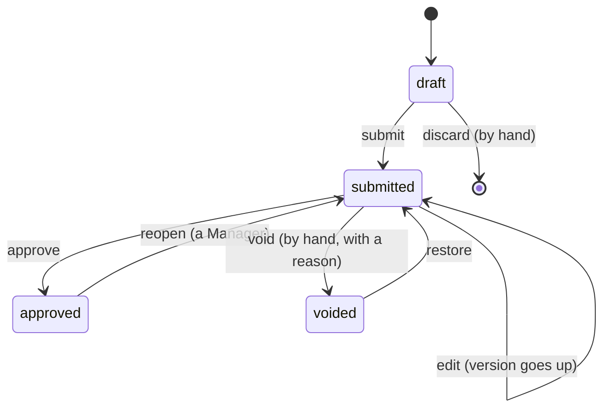
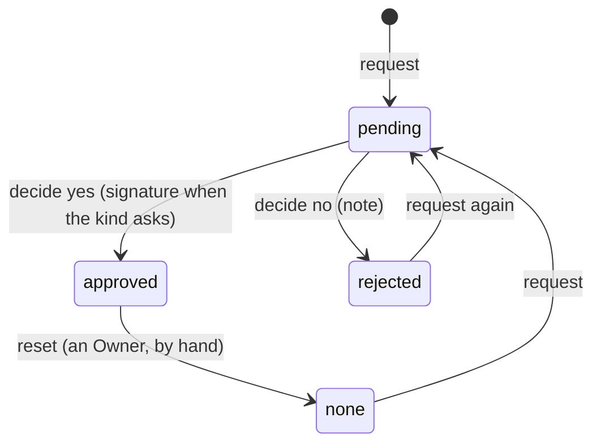

# Statecharts

The lifecycle of each core record. W11 (#11) and W21 (#21) hold these as tests: every state and transition here, and no other.

## Project stage (by kind)

```mermaid
stateDiagram-v2
    [*] --> open
    open --> open: move to another open stage
    open --> won: win (opens and numbers its proposed jobs; each needs a planned window unless it is workshop work)
    open --> lost: lose (needs a reason; a note when the reason asks for one)
    lost --> open: reopen
    won --> done: every job is finished or cancelled
    done --> won: reopen a job
    won --> open: un-win (only while no job of it has a report, crew day or booking; the jobs go back to proposed)
```

## Job

```mermaid
stateDiagram-v2
    [*] --> proposed: its project is created (a lead can be scheduled before it is won)
    proposed --> proposed: reschedule
    proposed --> open: its project is won, or it is opened from the planner (it takes its number)
    open --> proposed: its project is un-won
    open --> open: reschedule, record actual dates
    open --> finished: finish (actual end set)
    finished --> open: reopen
    open --> cancelled: cancel (by hand; refused once it has a submitted report)
```



## Daily report



An approved report does not change; a guard in the database holds that.

## Approval, job order, booking



A job order is `draft → issued`; issuing asks for the `job_order` approval and a new revision supersedes the last. An equipment booking is `booked → cancelled`; two live bookings of one thing may not overlap, which the core checks in the booking's transaction.
